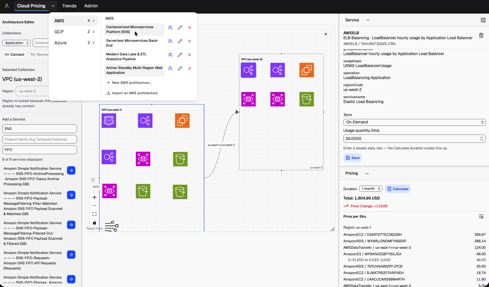

# Cloud Pricing App

A web application for designing cloud architectures and pricing them from real provider price
lists. You lay out an architecture on a canvas — application components, VPCs and the data
connectors between them — pick the exact services and SKUs each part uses from a searchable
catalog, and get a priced total for a chosen duration (on-demand, reserved, savings plan or
committed-use terms, per region). AWS, GCP and Azure are supported, and a Trends page shows how
each provider's list prices move over time.

Every price comes straight from the provider's published price list; anything that can't be
priced is shown as such, never estimated. The price lists come from a separate pipeline,
[cloud-pricing-data-retrieval](https://github.com/grp3d/cloud-pricing-data-retrieval), which
publishes versioned snapshots that the app reads from a local folder or S3.

<picture></picture>

## Getting started

Run the full stack on a laptop with Docker, using the pricing fixture committed in the repo:

```bash
deploy/app cert local --create              # once: a local TLS root in ./.local-tls (trust it)
cp .env.local.example .env.local            # once: set LOCAL_DATA_ROOT, e.g. to
                                            #   backend/tests/fixtures/pricing_parquet
docker compose --env-file .env.local -f compose.yaml -f compose.local.yaml up --build
```

Open `https://localhost:8443`. To work on the code with
live reload instead, see the [development guide](docs/development.md).

## Deploy

The app runs on demand in AWS: one command brings it up, one tears it down, and user data is
kept in backups between runs. After the one-time setup in [setup.md](docs/setup.md):

1. Merge to `main` and let CI pass.
2. Tag a release: `git tag -a v0.X.Y -m "…" && git push origin v0.X.Y`, and wait for the
   **release** workflow.
3. Bring it up: `deploy/app up --env prod`, or the **app** workflow with action `up`. The
   address is emailed to you.
4. Tear it down when you're done: `deploy/app down --env prod`. It takes a backup first.

Rollback, backups, logs and troubleshooting are in [operations.md](docs/operations.md).

## Reference

| Where | What |
|---|---|
| [CHANGELOG.md](CHANGELOG.md) | What each release added |
| [docs/features/](docs/features/) | How the app behaves today, one page per area |
| [docs/development.md](docs/development.md) | Running, testing and changing the code |
| [docs/configuration.md](docs/configuration.md) | Every setting, and the pricing data layout |
| [docs/setup.md](docs/setup.md) | First-time AWS setup, certificates on your devices |
| [docs/operations.md](docs/operations.md) | Up and down, releases, backups, rollback, logs, troubleshooting |
| [docs/brief/](docs/brief/) | The original design brief and change requests (inputs, not kept current) |
| `backend/` | FastAPI API, DuckDB over the pricing Parquet, Postgres for user data, ops CLI |
| `frontend/` | React + Vite + TypeScript web interface, unit and end-to-end tests |
| `infra/`, `deploy/`, `compose*.yaml` | AWS infrastructure (OpenTofu), the `deploy/app` command, the container stack |
| `specs/` | One folder per feature: specification, plan and tasks (Spec Kit) |
